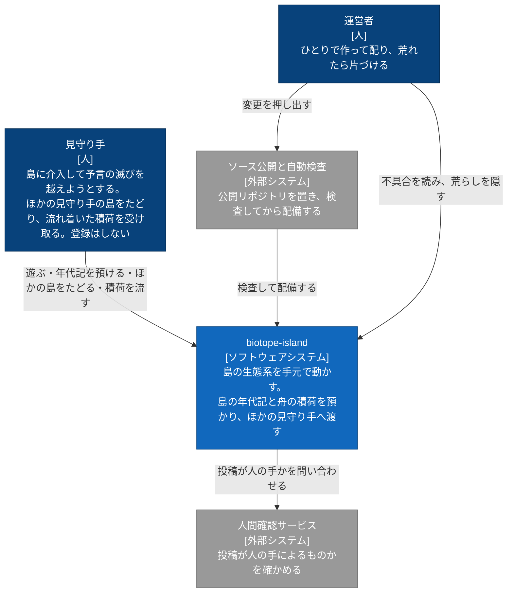
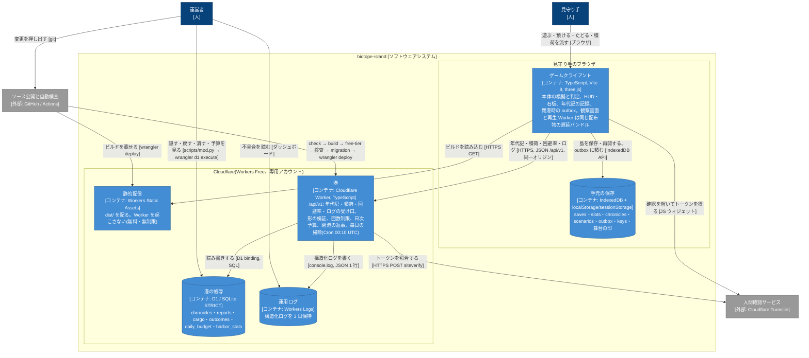
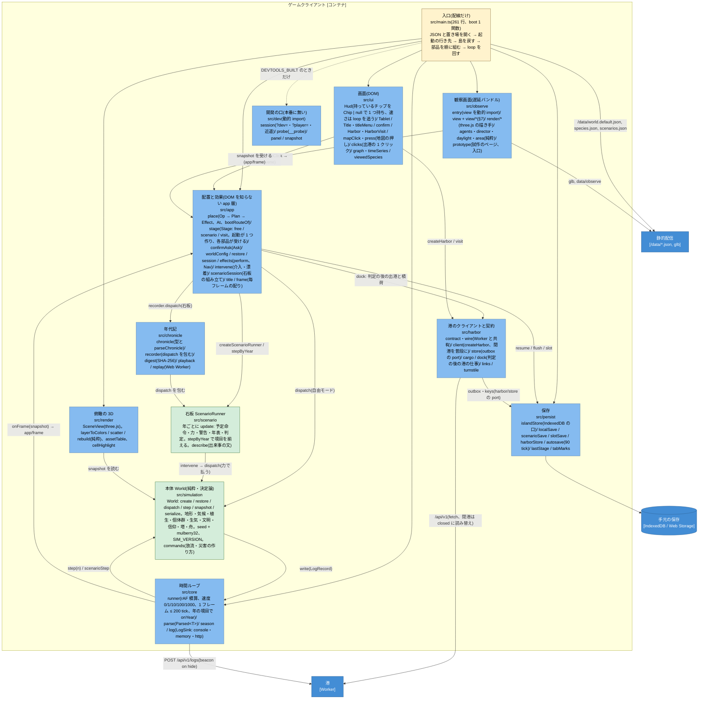
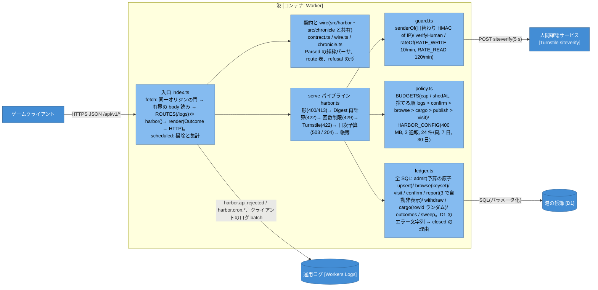
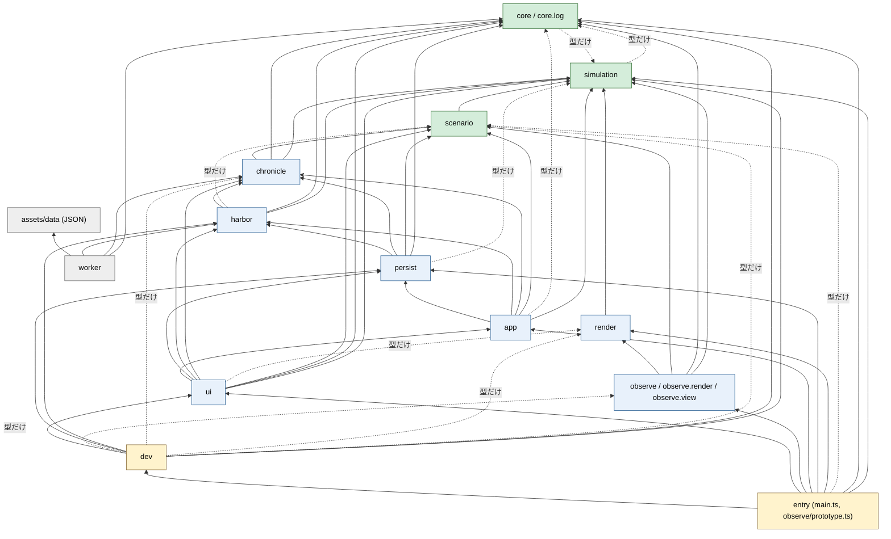

# アーキテクチャの概観(C4 と層の依存)

今のコードの構造を、C4(C1 Context / C2 Container / C3 Component)と層の依存図で描いた、保守する文書。
評価(ドライバ・ビューポイント・パースペクティブ・所見)は日付つきのレビュー `docs/design/2026-10-10-architecture-review.md` に、柵の方針は ADR `docs/decisions/0002-architecture-fence.md` に、柵の一覧は `fitness-functions.md` にある。この文書は「今どう組まれているか」だけを持つ。

- 対象: feat/m27-05 の **9fa690b**(M27-05 の 7 段すべて取り込み済み)。§8 に M27-05 で変わった所の要約を書く。
- 図は mermaid の `flowchart` + classDef。人・外部システム・コンテナの名前は Cloudflare の設計書 09-26 §4 と同じ。C1・C2・港の C3 はレビュー 10-10 のものを再掲し、クライアントの C3 と層の依存は M27(柵・循環の解消・main.ts と view.ts の部品化)の後の形に描き直した。
- 層の依存図(§5)は手で描かない。`node tools/layer-graph.ts` が TypeScript の AST から出す(値の辺は実線、型だけの辺は破線)。許可の表に無い辺があれば非 0 で終わる。
- 構造の言明には、それを守る柵の ID(`fitness-functions.md` の FF-xx)を添える。柵の無い言明は「文書だけの約束」なので、そう書く。

---

## 1. C1: System Context

## 2. C2: Container

コンテナの中の約束で柵のあるもの: 本番の bundle に試験・開発の口が無い(FF-10)、課金になる構成を入れない(FF-11)、配るもの・配らないもの(FF-12)、港が閉まっても遊ぶ・保存するは止まらない(FF-17)、D1 の無料枠の内で自分から閉まる(FF-18)、日次の掃除(FF-19)。

## 3. C3: ゲームクライアントのコンポーネント

層(`src/<層>/`)を部品の単位にする。各箱の 2 行目が置き場、3 行目が主な部品。線は主な向きだけで、全部の辺は §5 の依存図が持つ。

箱の中の約束と柵:

| 言明 | 柵 |
|---|---|
| `simulation`・`core`・`scenario` は DOM・three.js・fetch を知らない。`simulation` の外部パッケージは `simplex-noise` だけ | FF-04・FF-05・FF-27 |
| 層の向きは一方向で、循環が無い(M27-02 で `harbor ↔ ui`・`chronicle ↔ harbor`・`harbor ↔ persist`・`app ↔ ui` を解いた) | FF-01・FF-02・FF-03 |
| `main.ts` は配線だけ(261 行以下、`boot` 218 行以下)。規則は `src/app` の純粋な部品に置く | FF-07・FF-09 |
| `Chronicle` の型と `parseChronicle` は `chronicle/` が持ち、港の wire(`harbor/contract`)はそれを読む | FF-01(harbor → chronicle の向き) |
| 命令の作り方(放流の半径・量、災害の半径)は `simulation/commands.ts` が 1 つ持ち、UI・積荷・台本が同じ入口を通る(M21-01) | FF-30 |
| 舞台(自由・石板・訪問)の真偽は起動が `Stage` の union で 1 つ作り、部品は `stage` を受ける。`visiting` の真偽を部品が自分で引かない | FF-28(「訪問かどうか (visiting) を引くのは舞台 (Stage) の射影 1 か所だけ」) |
| `Session` は { world, selected, scenario, viewing } で、石板の組は `session.scenario: ScenarioSession \| null` に置く。`() => {}` の仮の値を置かない | FF-29(「Session に仮の値 (() => {}) が無い」) |
| 持っているチップ(災害・放流・気象塔)は HUD が `Chip \| null` 1 つで持ち、main.ts は写さず `hud.chip()` を読む | FF-31(「main.ts は HUD の手 (災害・放流・気象塔のチップ) を写さない」) |
| 速さの正は `core/runner` の loop に置き、HUD が追う。app・main.ts は DOM の id (`speed-N`) を押さない | FF-32(「速さを変えるのに DOM の id (speed-N) を押さない」) |
| 港の手元の置き場(`open*Store`)は入口が島の置き場と同じ DB で開き、`mountHarbor` に渡す | FF-33(「置き場 (open*Store) を開くのは入口 (main.ts) だけ」) |
| 観察画面は `observe/entry` が `view` を動的 import する遅延バンドルで、`ui`・`harbor`・`persist`・`chronicle`・`app` を読まない | FF-01・FF-02(`ALLOWED.observe`) |
| 開発の口は `dev/` にまとめ、入口だけが動的 import する。本番の bundle に印が無い | FF-10・FF-26(`ALLOWED` で dev を読めるのは entry だけ) |

## 4. C3: 港(Worker)のコンポーネント

Worker が `src/` から読むのは `chronicle`・`core`・`harbor` だけ(FF-06、`ALLOWED.worker`)。本体・UI・保存は Worker に持ち込まない。

## 5. 層と依存

層は `src/` の直下のディレクトリ(`core/log` は core、`observe/render`・`observe/view` は observe)。入口は `layering.config.mjs` の `ENTRY`(`src/main.ts`・`src/observe/prototype.ts`)で名指しし、`worker/src` は worker。表に無いディレクトリや `src` 直下のファイルは「知らない層」として柵が落とす(FF-26)。

### 5.1 許可の表(`layering.config.mjs` の `ALLOWED`・`PACKAGES`)

| 層 | 読んでよい層(自分の層は常によい) | 読んでよい外部パッケージ |
|---|---|---|
| simulation | core | simplex-noise |
| core | simulation | — |
| scenario | core, simulation | — |
| render | core, simulation | three |
| chronicle | core, scenario, simulation | — |
| harbor | chronicle, core, scenario, simulation | — |
| persist | chronicle, core, harbor, scenario, simulation | — |
| app | chronicle, core, harbor, persist, scenario, simulation | — |
| observe | core, render, scenario, simulation | three |
| ui | app, chronicle, core, harbor, persist, render, scenario, simulation | — |
| dev | src の全層 | — |
| entry | src の全層と dev | — |
| worker | assets(assets/data の JSON), chronicle, core, harbor | — |

- eslint の `no-restricted-imports` は同じ表の裏返し(`FORBIDDEN`)を静的な import に当て、編集中と CI で落とす(FF-01)。試験は動的 import と深い相対パスと型だけの辺にも当てる(FF-02)。
- `simulation` と `core` は型だけを互いに読む(`core/runner` が `WorldSnapshot` を、`simulation/World` が `LogSink` を)。値の循環は無い(FF-03)。
- `ui → app` は `Hud` が `slotControlsOf`(枠の札を押せるか)と `Session` の型を読む辺。`app` は DOM を知らないので逆向きは無い。

### 5.2 依存図(実測、`node tools/layer-graph.ts` の出力)

レビュー 10-10 §5.8 にあった 4 つの循環(`chronicle ↔ harbor`、`harbor ↔ persist`、`harbor ↔ ui`、`app ↔ ui`)は M27-02 で解いた(年代記の型を `chronicle/` へ、outbox の port を `harbor/store` へ、`visitHref` を `harbor/links` へ、漂着の 1 クリックを `harbor/cargo` へ、`Ask` を `app/confirmAsk` へ、`describeEvent` を `scenario/describe` へ)。

### 5.3 大きさのラチェット

| 対象 | 上限 | 柵 |
|---|---|---|
| ファイル | 既定 700 行。例外は `FILE_LINES`(`src/main.ts` 261、`src/simulation/World.ts` 985) | FF-07・FF-08 |
| 関数の本体 | 既定 150 行。例外は `LONG_FUNCTIONS` の 12 件(`boot` 218、`createHud` 447、`createScenarioRunner` 424、`createMotes` 365 ほか)。下げたら表も下げる | FF-09 |

## 6. 入口の配線(`src/main.ts` の `boot` の順)

main.ts は規則を持たず、部品を順に組む。順は依存で決まる(後の部品が前の部品を受ける)。

```mermaid
flowchart TB
  classDef step fill:#e8f1fb,stroke:#2e6295,color:#000
  classDef pure fill:#d4edda,stroke:#3c763d,color:#000

  s1["1. ログの sink と開発の口<br/>createAppLogSink、dev/session(?dev=・?player=)、dev/probe"]:::step
  s2["2. 読み込み(並列)<br/>/data の JSON 3 つ、openIslandStore と openHarborStore(IndexedDB。港の置き場は島の置き場と同じ DB 名で、開けなければ memory store)"]:::step
  s3["3. 起動の行き先<br/>bootRouteOf(URL・移る途中の枠・タブの印)→ タイトル or 舞台<br/>app/title: enterFromTitle"]:::pure
  s4["4. 舞台と島の設定<br/>bootSeedOf、scenarioConfigOf、stage = stageOf(booted)(free / scenario / visit の union)、markStage(最後に遊んだ舞台)"]:::pure
  s5["5. 島を戻す<br/>app/restore: 枠 → 石板の続き → 自動の続き → 新しい島。sessionOf(world)"]:::step
  s6["6. 地図と確かめ<br/>createSceneView(three.js)、createConfirm(DOM)"]:::step
  s7["7. 介入と効果<br/>createIntervene({ session, stage })(舞台で道を 1 つ選ぶ)、at = atOf(stage, ...)、createEffects(perform、Nav)、run = runPlan(planOp(op, at()))"]:::pure
  s8["8. 画面<br/>createHud(speed: () => loop.getSpeed()、onArm)、createTablet、mountHarbor(stage・config・store を受ける)、createObserveEntry(buttonHost: hud.speedRow)"]:::step
  s9["9. 時間ループ<br/>createRunner(step: 石板なら session.scenario.step、onYear → HUD の点、onFrame → app/frame)"]:::step
  s10["10. 石板の組み立て(自由モード以外)<br/>session.scenario = createScenarioSession({ stage, loop, harbor, observe, ... }): runner・記録器・自動保存・始め直し・訪問の再生"]:::step
  s11["11. 地図の押しと開発の板<br/>mountMapClick(hud.chip() → 命令)、dev.mount、loop.start()"]:::step

  s1 --> s2 --> s3 --> s4 --> s5 --> s6 --> s7 --> s8 --> s9 --> s10 --> s11
```

- 緑は DOM を知らない純粋な判断(`src/app`)。青は DOM・IndexedDB・three.js に触る組み立て。
- やり直しの効かない操作(新しい島・読込・枠へ保存・石板を選ぶ・もう一度・訪れる・タイトルへ)は全部 `run(op)` を通る: `planOp` が確かめ(`Ask`)と効果の列(`Effect[]`)を決め、`runPlan` が確かめてから `perform` を順に行う(`app/place.ts`・`app/effects.ts`、単体試験 `tests/unit/app.place.test.ts`・`app.effects.test.ts`)。
- 毎フレームは `app/frame.ts` が 1 か所で配る: 自動保存の tick → 観察画面へ snapshot → 地図 → HUD → 石板の判定と買えるチップ。

## 7. 観察画面の部品(`src/observe/view.ts` と `view/`)

M27-04 で 1 関数 836 行の `createObservationView` を 12 の部品に分けた(`view.ts` 165 行、入口の関数 126 行)。組む順が描く物を決める(鐘樹 → 株 → 森の木 → 下草 → 蛍 → 光の粒の順で同じ乱数 `mulberry32(11)` を引く)ので、順は変えない。

| 部品 | 受け持ち |
|---|---|
| `view/options` | URL の指定 `OPT`(shot・time・freeze・ship・auto・depart …)と区域の半径 |
| `view/host` | `ObserveHost`(本体の時計・名前・now・debug の口) |
| `view/state` | `ViewState`: 組んだ後に書き換わり、ほかの部品が読む値を 1 つに |
| `view/stage` | 描き手・場面・空・カメラ・光、合成(bloom・grade)と resize、捨て方 |
| `view/layout` | 区域・目印・船台・踏み固め(鐘樹より先に決める) |
| `view/flora` | 鐘樹・森の木・下草・植え直し |
| `view/settlementBuild` | 集落の部品・小屋の組・蛍・跳ね返りの面・光の粒・水たまり・舟 |
| `view/agentLayer` | 個体層(鹿・狼・兎の VAT) |
| `view/sea` | 沈む海 |
| `view/camera` | 寄せ先(presets)・自動カメラ(director)・押した個体を追う |
| `view/weather` | 介入の場面・灯り・知らせの帯・fx |
| `view/frame` | 毎コマの loop、本体の時間を進める、start・stop |

描く物が同じことは特性試験(FF-25、3 視点の `inspect()` を fixture に留める)と計測の台(FF-23)で守る。

## 8. M27-05 で変わった所(済み)

票 `issues/M27-05-stage-union-and-command-layer.md`(status: review)。7 段すべてを feat/m27-05 に取り込み済み。柵は FF-26〜FF-33(`tests/unit/architecture.test.ts` の describe「アーキテクチャの柵 (M27-05)」)。

| 段 | 変わった所 | コミット |
|---|---|---|
| 0 | 柵 6 本を先に赤で置いた | 6f0e945 |
| 1 | 起動が舞台 `Stage`(free / scenario / visit)を 1 つ作り、各部品は `stage` を受ける | 6b6db6d |
| 2 | `Session.scenario: ScenarioSession \| null`。介入の道は舞台ごとに 1 つ | d75f08e |
| 3 | 命令の作り方を `simulation/commands.ts` へ | 3a26ff3 |
| 4 | 持っているチップは HUD が `Chip \| null` 1 つで持つ | 6942945 |
| 5 | 速さの正は `core/runner` に置き、HUD が追う | a8058b4 |
| 6 | 層の表を許可の形に(§5) | e03da61 |
| 7 | 港の置き場は入口が開いて `mountHarbor` に渡す | 9fa690b |

経緯と確かめ、古くなった注釈の候補は票の作業ログにある。

## 9. 更新の手順

1. 層を足す・向きを変える: `layering.config.mjs` の `ALLOWED`(と `PACKAGES`)を直す → `pnpm run check` → `node tools/layer-graph.ts` の出力で §5.2 を差し替える → §5.1 の表を揃える。
2. 入口の配線を変える: §6 の順を直す。`main.ts` の行数の柵(FF-07)が増える変更は、規則を `src/app` へ出す。
3. 部品を分ける・動かす: §3 の箱の 3 行目と §7 の表を直す。古くなった注釈の候補は票の作業ログへ(既存コメントの書き換えは承認制)。
4. 新しい柵を足したら `fitness-functions.md` に 1 行、ここでは言明の横に FF の ID を添える。
