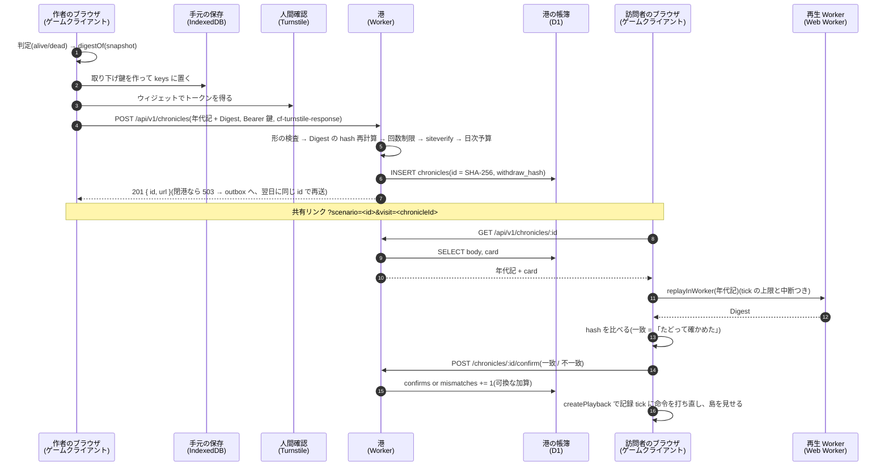
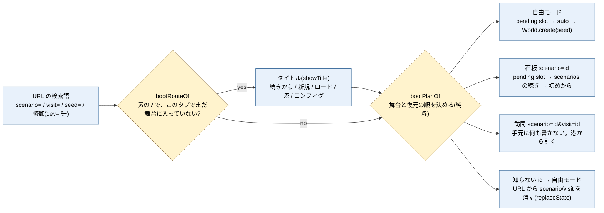
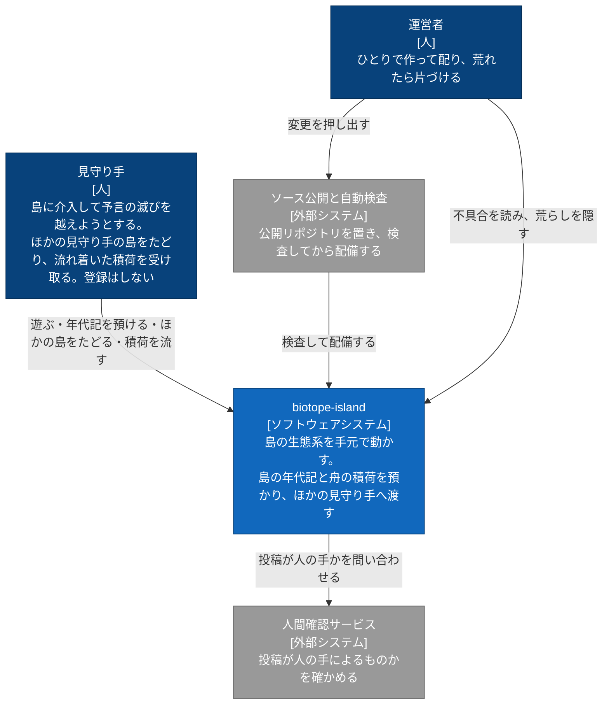
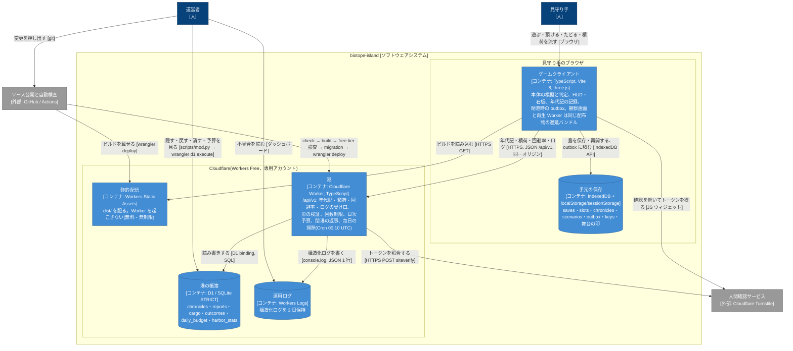
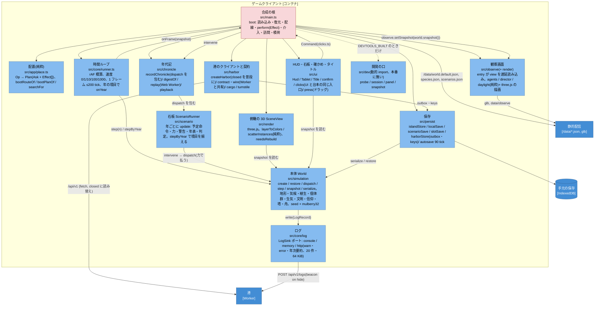
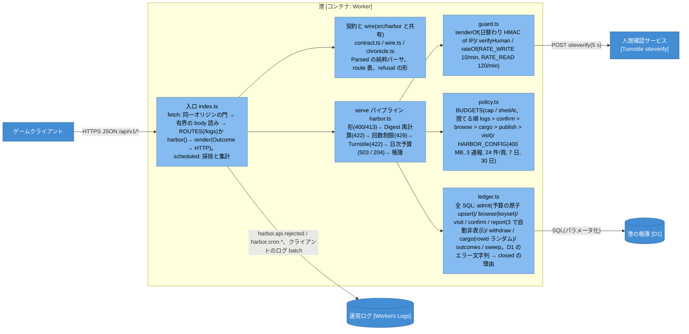
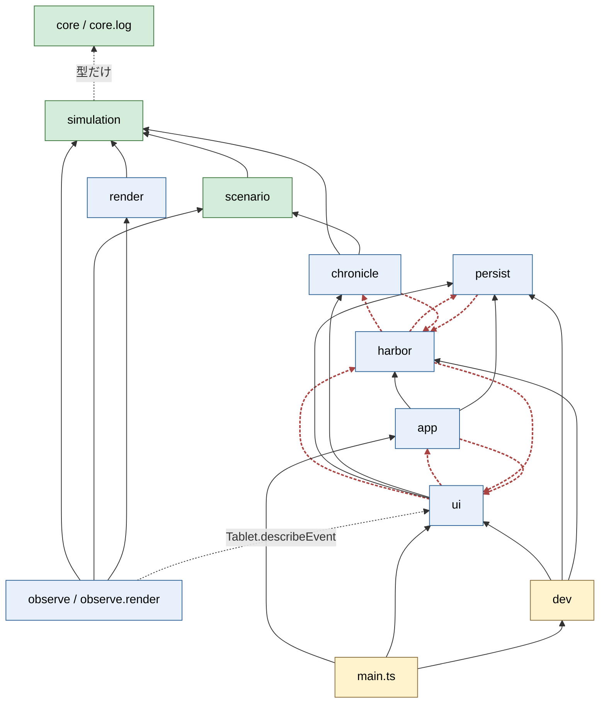

# アーキテクチャレビュー(2026-10-10): ドライバ・ビューポイント・パースペクティブ・C4

- 対象: feat/m19 の先頭 **1f83a26**(origin/main cdbfa30 の 53 commit 先。main に入っていない M19・M21・M22・M24(00・01・04・05)・M25・M26 を含む)。親の checkout(feat/m21 d419c0b)は main の 128 commit 後ろで、`worker/`・`src/persist`・`src/harbor` を持たないので、この文書は feat/m21 からは読まないこと。
- 作り方: コード(`src/`・`worker/`・`scripts/`・`tests/`・`.github/`)と設計文書(設計書 09-19、シナリオ層 09-19、Cloudflare 09-26、保存と URL 09-27、受入 ADR 0001、タイトル遷移 10-04)を読み、ドライバごとに「今の状態」を試験名・ファイルで裏づけた。M24-02(メニュー)・M24-03(石板の選択と港)は未着手なので「これからの変化」としてだけ触れる。
- 図は mermaid の `flowchart` + classDef で描く。09-26 の設計書 §4 と同じ決め(C4-PlantUML は日本語の長いラベルが重なり、外部 include が要る)。人・外部システム・コンテナの名前は 09-26 と同じにし、この文書は **C3(コンポーネント)** を足す。
- 枠組み: Rozanski & Woods の 7 ビューポイント(Context / Functional / Information / Concurrency / Development / Deployment / Operational)と、パースペクティブ(Security / Performance & Scalability / Availability & Resilience / Evolution / Accessibility / Usability / Internationalization / Regulation=個人情報 / Development Resource)。

---

## 0. 要約(半ページ)

**このシステムを形作っている品質特性は 3 つ**で、ほかはこの 3 つに従属させてある。

| 順 | 特性 | なぜ最上位か | 守っている構造 |
|---|---|---|---|
| 1 | **決定論**(Q3) | 年代記の共有・訪問者の照合・回避率・石板の年表・受入の基準画が全部これに乗る | `World` は seed と `mulberry32` だけ(`Math.random`・`Date.now` を使わない)。`stepByYear` で年の境目ごとに評価(速度と fps に依らない)。`SIM_VERSION` と golden replay(`tests/unit/scenario.determinism.test.ts:193`) |
| 2 | **費用の硬い上限と非対称な劣化**(Q1・Q2・B7) | 運営 1 人・月 0 円。無料枠は毎日 UTC 0 時に戻るので「天井に当たると壊れる」設計は毎日壊れる | 島はブラウザで回し、港(Worker + D1)には年代記だけ。`scripts/check_free_tier.py` を CI と deploy に入れ、港は日次予算で**自分から閉まる**。閉港でも遊ぶ・保存するは止まらない(`createHarbor` は baseUrl が無ければ常に閉港で、E2E はその状態で走る) |
| 3 | **試験可能性と観測性**(Q9・B3・ADR 0001) | 校正・受入・回帰を機械に寄せないと 1 人では回らない。配った先の不具合はログでしか分からない | 本体は純粋関数の集まり、契約は `Parsed<T>` の純粋パーサ、Worker はローカル D1 で単体試験。構造化ログ(`LogSink` ポート、HTTP sink、Workers Logs)。受入は正本 `scenarios.jsonl` → lens・基準画・LLM 採点。本番 bundle に試験の口が無いことを build 試験で縛る |

**健全なところ**: `simulation` → `scenario` → UI の依存は一方向で、`simulation` は three.js・DOM・fetch を知らない。本体を変えずに年代記を取る `recordChronicle`、`Op → Plan → Effect` の純粋な配置層(`src/app/place.ts`)、契約をクライアントと Worker で同じファイルから import する形、閉港を「普段の状態」として UI に言葉を持たせた形は、どれも上の 3 特性を構造で守っている。

**直したほうがよい所見(優先順)**:

1. **周辺モジュールの循環と向き**(Evolution・Development): `harbor → ui/clicks`、`app ↔ ui`、`harbor ↔ persist`、`chronicle ↔ harbor`。`Chronicle` の型が `harbor/` の下にあるのが根で、年代記の意味を「港の wire」に縛っている。§6 の R1。
2. **合成の根の肥大**(Development): `src/main.ts` は設計書で「配線のみ」だが 623 行・閉包 35 個で、再開・確かめ・介入・訪問・積荷の規則を抱える。`src/observe/view.ts` も 1 関数 835 行。§6 の R2。
3. **文書とコードのずれ**(Development・Operational): 設計書 09-19 は「保存は JSON ファイルだけ」「E2E はスモーク 1 本」のまま。Cloudflare 09-26 §6.1 の最悪の D1 書き「約 43%」はコードの注(`worker/src/policy.ts:12`)では 88,000 行(88%)。§6 の R3。
4. **受け入れたリスクの明文化**(Security): confirm・outcomes は人間確認なしで、回避率は送り手あたり 10 回/分まで汚せる。順位を作らない設計なので動機は薄いが、ADR に「受け入れたリスク」として書いておく。§6 の R4。

---

## 1. 用語の対応(この文書を読むために)

コードと文書は世界観の言葉で書かれている。アーキテクチャの語との対応を先に置く。

| 世界観の語 | アーキテクチャの語 | 置き場 |
|---|---|---|
| 島・本体 | 生態系シミュレーションの集約 `World`(決定論、密度モデル) | `src/simulation` |
| 石板・予言 | シナリオ定義(予定命令・判定条件・予算) | `assets/data/scenarios.json`、`src/scenario` |
| 星の力 | 介入の予算(年ごとの収入と維持費) | `ScenarioRunner` |
| 見守り手 | プレイヤー(登録なし) | — |
| 年代記 | 介入の時刻表 `{simVersion, scenarioId, seed, commands[], yearly[]}`。共有の単位(数 KB) | `src/harbor/chronicle.ts`(型)、`src/chronicle`(記録・再生) |
| 結末の要約(Digest) | 判定・年・種ごとの総数の正規化 JSON の SHA-256 | `src/chronicle/digest.ts` |
| 港 | Cloudflare Worker(API) + D1(帳簿) | `worker/`、`wrangler.jsonc` |
| 出港・訪問・取り下げ | 年代記の publish / visit / withdraw | `/api/v1/chronicles*` |
| 積荷・漂着 | 空の舟で逃がした種を、別の島がランダムに 1 件引く非同期の渡り | `/api/v1/cargo` |
| 閉港 | 無料枠・日次予算・D1 制限で API が 503 を返す普段の状態。outbox で翌日再送 | `src/harbor/client.ts`、`worker/src/policy.ts` |
| 観察画面 | 集落のまわり半径 8 の 3D ビュー(別バンドル、遅延読み込み) | `src/observe` |
| 枠・舞台 | 保存スロット(auto / manual-1..3 / import)と、URL が決める「自由モード / 石板 / 訪問」 | `src/persist`、`src/app/place.ts` |
| 審査台・受入・judge | 開発時の受入自動化(基準画の承認 UI、LLM 採点) | `.claude/localreview`、`scripts/judge.py` |

---

## 2. アーキテクチャドライバ

優先度は MoSCoW。「状態」は 満 / 部分 / 未 / 未検証。ID は 09-26 の設計書(B・Q・C)を保ち、そこに無かったものを F(陽機能)・G(本体の品質)・P(開発プロセス)として足す。

### 2.1 業務要件(B)

| ID | 要件 | 優先度 | 状態 | 証跡 |
|---|---|---|---|---|
| B1 | 誰でもブラウザで、登録なしですぐ遊べる | Must | 満 | Workers Static Assets + SPA fallback(`wrangler.jsonc` assets)。アカウント無し。`tests/e2e/smoke.spec.ts` |
| B2 | 自分の島を保存し、閉じても続きから遊べる | Must | 満 | IndexedDB `biotope-island`(`src/persist/islandStore.ts`)、90 tick ごとの自動保存(`persist/autosave.ts`)、石板は島 + runner + 年代記を同じ transaction で(`persist/scenarioSave.ts`)。`tests/e2e/persist.spec.ts`・`scenarioSave.spec.ts` |
| B3 | 運営者が配った先の不具合と遊ばれ方を知れる | Must | 満 | `core/log/httpSink.ts`(warn/error と年次要約だけ、20 件・64 KiB のバッチ)→ `POST /api/v1/logs` → Workers Logs(3 日)。`tests/e2e/logsink.spec.ts`、`tests/e2e-cloudflare/harbor.spec.ts` |
| B4 | 年代記を預け、リンクで見せ、他人の島をたどって観察画面で見る | Should | 満 | `createHarbor.publish/browse/visit`、`?scenario=&visit=`、`createPlayback` で記録 tick に命令を打ち直す。`tests/e2e/harbor.spec.ts`、`chronicle.spec.ts`(本物の Web Worker で再生) |
| B5 | 空の舟の積荷がほかの島へ流れ着く | Should | 満 | `simulation/ship.ts exportCargo` → `POST /cargo`、`GET /cargo`(rowid ランダム)→ `harbor/cargo.ts planLanding` → 受け取れば `dispatch`。`tests/unit/harbor.cargo.test.ts`、e2e-cloudflare |
| B6 | 予言ごとの回避率 | Could | 満 | `outcomes` 表、`GET /outcomes/:scenario`。`HBR` の受入行 |
| B7 | 運営は 1 人の趣味で月 0 円 | Must | 満 | 専用アカウント・支払い方法なし(運用の決まり、`docs/operations/cloudflare.md`)。`check_free_tier.py` を CI と deploy で |
| B8 | 中心体験は「気づく」。介入と結果の因果が目で追える | Must | 満 | 時系列グラフ・レイヤー切替・セル詳細・石板の年表(`TimelineEvent`)。介入は `cmd.*` ログとして年表と神話(信仰)になる |
| B9 | 滅びの予言を回避する「シナリオ層」を、勝敗のない本体の上に被せる | Must | 満 | `ScenarioRunner` は `World` を知るが `World` は runner を知らない。30 本の設計のうち 11 本が遊べる(roadmap §1) |
| B10 | 公開リポジトリ(MIT)で開発し、AI 生成物の出自を明記する | Must | 満 | README「3D モデルとコンセプト画」、LFS、`scripts/check_readme.py`(README に運用手順を書かせない) |

### 2.2 陽機能要件(F)

| ID | 機能 | 優先度 | 状態 | 証跡 |
|---|---|---|---|---|
| F1 | 自由モード: 種を放つ・気候・災害・時間操作(0/1/10/100/1000x) | Must | 満 | `Command` 9 種(`simulation/types.ts`)、`core/runner.ts Speed`、`ui/clicks.ts` |
| F2 | 石板: 予定命令・星の力・警告・年表・判定(alive / dead / escaped) | Must | 満 | `ScenarioRunner.update` を年の境目ごとに、`judge.ts`、`warnings.ts`、`tests/slow/scenarios.playthrough`(放置 dead・素朴 dead・配分 alive) |
| F3 | 文明(7 段階)・信仰・祈り・勅令・気象塔・迎撃・空の舟 | Must | 満 | `simulation/{civilization,faith,prayer,edict,unrest,weatherTower,works,ship}.ts` |
| F4 | 観察画面(3D、集落と生き物、昼夜・天候・知らせ) | Must(M22 で最優先) | 満 | `observe/entry.ts` が初回に遅延読み込み。LOD・インポスター・VAT・動的解像度(M23) |
| F5 | 保存の枠(auto・手動 3・ファイル)と、URL の舞台(自由 / 石板 / 訪問)の一貫 | Must | 満 | `app/place.ts bootPlanOf/searchFor`、`SlotSave` の包み(09-27 §3)。`tests/e2e/scenarioSave.spec.ts`・`freeIslandSeed.spec.ts` |
| F6 | 港: 出港・一覧・訪問・照合・通報・取り下げ | Should | 満 | §2.1 B4。通報 3 送り手で自動非表示、取り下げ鍵は手元で作り D1 にはハッシュ |
| F7 | 取り返しのつかない操作の確かめ(新しい島・読込・移動) | Must | 満 | `Risky → Ask` を `planOp` が純粋に決め、`createConfirm` が聞く。`tests/e2e/confirm.spec.ts` |
| F8 | タイトル画面・メニュー・ロード・コンフィグ | Should | 部分 | `ui/Title.ts`・`bootRouteOf`・「タイトルへ」・舞台ごとの続き(M24-00・01・04・05、e8430b5 で取り込み済み)。M24-02 メニュー・M24-03 石板の選択と港は todo |
| F9 | 開発・受入の口(`?dev=1`、`window.__probe`、tick で止める、決定論の撮影) | Must(開発) | 満 | `src/dev/*` は `DEVTOOLS_BUILT` の下で動的 import。`tests/unit/build.devtools.test.ts` が本番 bundle に無いことを縛る |

### 2.3 品質特性(Q・G)

| ID | 品質特性 | 優先度 | 状態 | 証跡と測り方 |
|---|---|---|---|---|
| Q1 | 費用の上限が硬い(課金にならない) | Must | 満 | `check_free_tier.py`(binding の許可リスト、`.assetsignore`、dist の数と大きさ)。`deploy.yml` でも実行 |
| Q2 | 劣化の非対称(港が閉まっても遊ぶ・保存するは止まらない) | Must | 満 | `main.ts` は静的アセット以外に頼らず起動。閉港は `closed` に読み替え、出港は outbox へ(`persist/harborStore.ts`)。捨てる順は logs > confirm > browse > cargo > publish > visit(`policy.ts`) |
| Q3 | 決定論(同じ版・同じ年代記は誰のブラウザでも同じ結末) | Must | 満 | `scenario.determinism.test.ts`(1x〜1000x とフレーム間隔 4 通りの結末一致、golden replay)。`chronicle.test.ts`・`chronicle.spec.ts`(Chromium の Web Worker で同じ hash)。C6 は M19-04 で閉じた |
| Q4 | 運用の手間(ふだん月数分、荒れた日も 1 コマンド) | Must | 満 | `scripts/mod.py`(hide / restore / delete / budget)、`scripts/deploy.py`、Cron 1 本の掃除 |
| Q5 | 匿名の投稿に耐える | Must | 満 | 形の検証(`Parsed<T>`、Content-Length 先読み、`readBounded`)→ 回数制限(binding)→ Turnstile(出港・通報)→ 日次予算 → D1。自由文を受けない |
| Q6 | 個人情報を持たない | Must | 満 | 生 IP を保存しない(日替わり HMAC の送り手ハッシュ、通報の行にその日だけ)。D1 の schema 先頭に明記 |
| Q7 | 秘密をリポジトリに置かない | Must | 満 | `wrangler.jsonc` は名前だけ。Keychain のトークンは子プロセスの env だけ(`scripts/cf_auth.py`)。`git-secrets` |
| Q8 | 観察画面の性能予算(draw call ≤200・三角形 ≤1.5M・60 fps)を共有機能が食わない | Should | 満 | 再生は Web Worker(`chronicle/replayInWorker.ts`)。観察中は速度 10x 上限、動的解像度 0.5〜1.0。`tools/bench-observe.ts` |
| Q9 | 試しやすさ(契約は純粋関数、Worker はローカル D1) | Should | 満 | 単体 132 ファイル、worker 5 ファイル(miniflare D1)、E2E 20 spec、e2e-cloudflare 1 |
| G1 | 本体の純粋性(`World` は three.js・DOM・fetch を知らない。規則は型付き配列を受ける純粋関数) | Must | 満 | `src/simulation` の外部 import は `simplex-noise` と `core/log/types`(型)だけ |
| G2 | 本体の描画非依存(SceneView と Hud は `snapshot()` を読むだけ、書き込みは `Command` だけ) | Must | 満 | `render → simulation` のみ。`snapshot()` はコピーしない(読み取り専用は慣習) |
| G3 | 通し実行の台本と UI の手の同一(「台本が UI より 10 倍強い」を再発させない) | Must | 満 | `src/ui/clicks.ts` を台本も使う(M21-01)。環 1・0.5・力 4 の規約(issues/README) |
| G4 | 受入の機械化(人の 1 周 13 分 → 1〜4 分) | Must | 満 | ADR 0001。lens(覆い・画面内・切れ・コントラスト 4.5・11px)、要素ごとの基準画(2%、細い板 12%)、`judge.py` の 3 票 |
| G5 | 版の中でだけの決定論(係数を変えたら `SIM_VERSION` を上げる) | Must | 満 | golden replay が上げ忘れを落とす。旧版の年代記は要約だけ(C5) |
| G6 | 読みやすさ・到達性(コントラスト、字の大きさ、`prefers-reduced-motion`) | Should | 満 | `tests/e2e/lens.ts`、`graphDescription.ts`(グラフの文の説明)、Title・知らせ・観察入口が reduced-motion を見る |

### 2.4 制約(C)

| ID | 制約 | 状態 | 備考 |
|---|---|---|---|
| C1 | Workers Free と D1 だけ | 満 | R2・KV・Queues・DO は許可リストで拒否 |
| C2 | Worker の CPU 10 ms(サーバーで本体を回せない) | 満 | 照合は訪問者のブラウザの Web Worker |
| C3〜C4 | R2 は超過で課金、D1 は超過で失敗 | 満 | D1 を選び、内部の栓 400 MB |
| C5 | 本体は版の中でだけ決定論的 | 満 | `SIM_VERSION = '1'` |
| C6 | 本体がフレームの刻みに依存していた | **閉じた** | `stepByYear`(M19-04) |
| C7 | 既存の型に合わせる(`LogSink`・`Command`・`SaveData`・`clicks.ts`) | 満 | — |
| C8 | 枠はアカウント単位 | 満 | 専用アカウント、`account_id` を固定 |
| C9 | 日本語のみ(`lang="ja"`、i18n 層なし) | — | 対象読者の決め(ムー読者の中高生) |
| C10 | 3D モデル・PNG は Git LFS | — | CI は `lfs: true`、deploy.py は pointer を検査 |
| C11 | 本番 bundle に試験の口を入れない | 満 | `build.devtools.test.ts` |

### 2.5 開発プロセスのドライバ(P)

| ID | ドライバ | 根拠 | 守っている仕組み |
|---|---|---|---|
| P1 | シナリオは **レベルデザイン → キーアイテム → 校正** の順(係数で通さない) | M9〜M10R の教訓(roadmap §1) | `-00` の LD 票を depends_on に。`tests/slow` に放置 dead・素朴 dead・配分 alive を固定 |
| P2 | 受入基準に証跡(試験名・commit)を必須 | sprint-qa-process | `issues/*.md` の `evidence`、`scenarios.jsonl` の `covered_by` を `acceptance.py check` が実在検査 |
| P3 | 既存コメント・正本の行の書き換えは承認制 | CLAUDE.md | 審査台と「ユーザーの承認 <日付>」のコミット |
| P4 | agent は worktree で並列、取り込みは `--no-ff`、push・配備は許可制 | handoff | `deploy.yml` は手動・main のみ・Environment production |
| P5 | 通し実行(tests/slow、15〜20 分)は CI に入れない | 時間 | 手元で `caffeinate` + 分割 |

---

## 3. ビューポイントによる評価

| ビューポイント | 今の形 | 証跡 | 所見 |
|---|---|---|---|
| **Context** | 利用者 2 役(見守り手・運営者)、外部 3 つ(Turnstile、GitHub/Actions、Cloudflare の基盤)。開発時は Claude Code(judge)と Gemini(コンセプト画)が外部にある | 09-26 §4.1、§5 の C1 | 開発時の外部(LLM、画像生成)は本番の図に出さないのが正しい。ただし Development ビューに書く |
| **Functional** | 本体 `World`(集約 1 つ、命令 9 種、tick 固定)→ シナリオ `ScenarioRunner`(年ごと)→ UI(HUD・石板・港・確かめ)。観察画面は本体を読むだけ。港は年代記・積荷・回避率・ログの受け口 | §5 の C3 | 責務の境界は明快。例外は `main.ts` が持つ規則(§6 R2) |
| **Information** | 真実の置き場は 3 つ。本体の状態(`SaveData`、手元の IndexedDB、1.6 MB)、年代記(介入の時刻表、港の D1、≤16 KB)、受入の正本(`scenarios.jsonl`)。年代記の id は正規化 JSON の SHA-256(冪等)。D1 は STRICT、自由文なし、生 IP なし | `World.serialize`、`chronicles` 表、ADR 0001 | SaveData の `version:1` と `SIM_VERSION` と `RUNNER_STATE_VERSION` の 3 つの版が並ぶ。移行の規則(restore が欠けた場を seed から埋める)はあるが、3 つの関係を 1 か所に書いた文書が無い |
| **Concurrency** | 本体はメインスレッド、rAF の積算で 1 フレーム最大 200 tick。再生だけ Web Worker。自動保存は書き中は飛ばす。港の書き手は作者(出港・取り下げ)と訪問者(可換な加算)で重ならない | `core/runner.ts`、`replayInWorker.ts`、§5.1 09-26 | `snapshot()` が内部バッファを別名で返すので、observe の `setSnapshot` と view の読みが同じフレームで混ざらない前提に乗っている(今は同期なので安全)。本体を Worker 化するなら `Command` 境界が既にある |
| **Development** | TypeScript 単一リポジトリ、依存は three と simplex-noise だけ。層: simulation → scenario → {render, observe, ui, persist, harbor, chronicle, app} → main。試験 4 段(unit / slow / e2e / e2e-cloudflare)+ worker。受入の自動化は開発時の道具(審査台・judge) | §5.3 の依存図 | **循環 4 つ**(§6 R1)。`main.ts` 623 行、`observe/view.ts` 1074 行(§6 R2)。`tests/integration` は空(`.gitkeep` だけ)。設計書 09-19 の記述が古い(§6 R3) |
| **Deployment** | 1 Worker(静的 + `/api/*`)、D1 1 つ、Cron 1 本、Rate Limiting 2 つ、secret 2 つ。配備は GitHub Actions(手動、main のみ)か `deploy.py`(Keychain のトークン)。Preview URL なし | `wrangler.jsonc`、`deploy.yml`、`deploy-runbook.md` | 最小構成で、課金にならない構造を CI が守る。本番は f8ee7c1a のまま(10-07 時点)で、53 commit の差があるのは配備の判断待ち |
| **Operational** | ログは Workers Logs 3 日。日次の掃除と保存量の集計は Cron がログに書く。荒らしは `mod.py`。閉港は普段の状態 | `worker/src/index.ts scheduled`、`mod.py` | 「港が閉まった日」を運営者が知る口が無い(ログを見に行くだけ)。趣味の規模では許容だが、`harbor.cron.stats` を README の代わりに手元の 1 コマンドで読めると楽 |

---

## 4. パースペクティブによる評価

| パースペクティブ | 重要度 | 何をしているか | 証跡 | ギャップ・受け入れたリスク |
|---|---|---|---|---|
| **Security** | 高(匿名投稿) | 同一オリジンの門(認証ではないと明記)、Turnstile(出港・通報)、回数制限(送り手の日替わり HMAC)、日次予算、Content-Length 先読みと有界読み、カタログ id だけ受ける、取り下げ鍵は手元で作りハッシュだけ保存、パラメータ化 SQL、最小権限のトークン | `worker/src/{index,guard,harbor,ledger}.ts`、`cloudflare-api-token.md` | confirm・outcomes は人間確認なし(回避率は汚せる。順位が無いので動機は薄い)。logs は回数制限なしで日次予算だけ(fail-open、設計どおり)。CORS 無し = 同一オリジン限定(意図どおり) |
| **Performance & Scalability** | 中〜高(観察画面) | 観察画面: LOD・インポスター・VAT・視錐台カリング・動的解像度、三角形 1.40M → 303k(M23)。本体: 型付き配列、1 フレーム 200 tick 上限。港: 3,000 DAU の日で Workers 15%・D1 書き 4%。日次予算で最悪 88% | `docs/design/2026-09-24-observe-perf.md`、`policy.ts` | 本体は grid 128 がメイン。256(設計の暫定上限)での fps は未計測。港は約 20,000 DAU で天井(設計で承知) |
| **Availability & Resilience** | 高(非対称) | 静的配信は無料・無制限で港と分離。閉港の読み替え・outbox・翌日再送・捨てる順。D1 のエラー文字列を閉港の理由に写す。Rate Limiting binding が無くても通す(警告) | `client.ts`、`ledger.ts`、E2E は港閉じで走る | 港の状態の監視は無い。版を上げると旧版の年代記は要約だけ(受け入れたトレードオフ) |
| **Evolution** | 高(M11〜M18 が残る) | 本体は版と golden で守る。シナリオはデータ(`scenarios.json`)。`Command` 境界で Worker 化に備える。種 id → アセット表で glTF 差し替え | roadmap §4、`assetTable.ts` | 地形生成に手が入る M13・M15 は `SIM_VERSION` を上げる。周辺の循環(§6 R1)が新機能のたびに `main.ts` へ規則を足す圧力になる |
| **Accessibility** | 中 | lens(覆い・画面内・切れ・コントラスト ≥4.5・字 ≥11px)、`graphDescription`、reduced-motion | `tests/e2e/lens.ts`、ADR 0001 | 3D キャンバスの操作はマウス前提。キーボードだけで石板を選ぶ道の試験は無い |
| **Usability** | 高(「気づく」) | 介入の拒否理由を行に出す(M21-02)、確かめのダイアログ、閉港の言葉、UI と台本の同じ手 | `ui/harborText.ts`、`confirm.spec.ts` | 手触り(ドラッグの気持ちよさ)は人の 1 分に残す(ADR の決め) |
| **Internationalization** | 低(決め) | 日本語のみ | `lang="ja"` | 英語化するなら文字列が UI と `scenarios.json` と `inscriptions.json` に散っている |
| **Regulation(個人情報)** | 高 | アカウント無し、生 IP・メール・自由文を保存しない、送り手は日替わりで追えない、Workers Logs 3 日 | D1 schema の先頭の注 | クライアントのログ(`/logs`)に個人を特定する値を載せない規律は `shipsToServer` のフィルタ(warn/error と年次要約だけ)に依る |
| **Development Resource** | 高(1 人 + agent) | 定型は python スクリプト、受入は機械、票は Markdown + frontmatter、agent は worktree で並列 | `scripts/`、`issues/README.md` | 通し実行 15〜20 分は CI に入らず手元。基準画は Mac だけ |

---

## 5. 主要ユースケースと静的構造

### 5.1 ユースケース一覧

| # | 利用者 | きっかけ | 結果 | 通るコンテナ・部品 |
|---|---|---|---|---|
| UC1 | 見守り手 | `/` を開く | タイトル → 自由モードの島(続きがあれば続き) | ゲームクライアント(`bootRouteOf` → `showTitle` → `World.create / restore`)、手元の保存 |
| UC2 | 見守り手 | 種を放つ・雨・災害・時間 | 本体が次の tick で命令を適用し、グラフ・レイヤーが動く | `ui/clicks.ts` → `intervene` → `World.dispatch` → `stepOnce` → `SceneView.update`・`Hud.update` |
| UC3 | 見守り手 | `?scenario=sinking` で石板を背負う | 予定の滅びが年ごとに入り、力で介入、判定が出る | `ScenarioRunner`、`stepByYear`、`recordChronicle`、`createScenarioAutosave` |
| UC4 | 見守り手 | 観察画面に入る | 集落と生き物を 3D で眺める(本体は 10x まで) | `observe/entry.ts` が `view.ts` を遅延読み込み、`setSnapshot` |
| UC5 | 見守り手 | 枠へ保存・読込・新しい島 | 確かめのあと、舞台に合う枠だけを読む(違う舞台なら移る) | `planOp → runPlan`、`SlotSave`、sessionStorage の pending slot |
| UC6 | 見守り手 | 判定の後に「港へ出す」 | 年代記 + Digest を Turnstile 付きで出港。閉港なら outbox | `digestOf`、`createHarbor.publish`、`POST /chronicles` |
| UC7 | 見守り手(訪問者) | 共有リンク `?scenario=&visit=` | 年代記を引き、Web Worker で再生して Digest を照合、確認の印を積む。島を記録 tick で再生して見る | `GET /chronicles/:id`、`replayInWorker`、`POST /confirm`、`createPlayback` |
| UC8 | 見守り手 | 空の舟で逃がす / 漂着を引く | 積荷を港へ流す。別の島が 1 件引き、受け取れば外来種として `dispatch` | `exportCargo`、`POST/GET /cargo`、`planLanding` |
| UC9 | 運営者 | 荒らし・満杯・不具合 | `mod.py` で隠す・戻す・消す・予算を見る。Workers Logs を読む | 港の帳簿、運用ログ |
| UC10 | 運営者 | 配備 | Actions(手動・main)か `deploy.py`。check → build → free-tier 検査 → D1 migration → deploy → smoke | ソース公開と自動検査、静的配信、港 |
| UC11 | 開発者・agent | 受入 | `pnpm run shots` → lens・基準画 → 審査台で承認 → `judge` の 3 票 | 開発時の道具(本番には無い) |

### 5.2 出港 → 訪問 → 照合(アーキテクチャ上もっとも重い流れ)

### 5.3 起動の舞台決定(URL → 舞台 → 復元)

### 5.4 C4 — C1: System Context(09-26 §4.1 を再掲、名前を保つ)

### 5.5 C4 — C2: Container(09-26 §4.2 に、再生 Worker と観察画面の遅延バンドルを注記)

### 5.6 C4 — C3: ゲームクライアントのコンポーネント

赤の「合成の根」は所見 R2 の対象。線は主な向きだけで、§5.8 の依存図が全部の辺を持つ。

### 5.7 C4 — C3: 港(Worker)のコンポーネント

### 5.8 ディレクトリの依存(実測、2026-10-10)

赤の破線が循環。中身(ファイル単位):

| 循環 | 辺 | 原因 |
|---|---|---|
| chronicle ↔ harbor | `harbor/contract.ts` → `chronicle/digest`、`chronicle/{digest,replay,recorder,playback,replayInWorker}` → `harbor/chronicle`(型) | **`Chronicle` の型と `parseChronicle` が `harbor/` の下にある**。年代記の意味(記録・再生の単位)が港の wire の都合に置かれている |
| harbor ↔ persist | `harbor/client.ts` → `persist/harborStore`(型)、`persist/{harborStore,islandStore,scenarioSave,slotSave}` → `harbor/{chronicle,contract}` | 同上(保存が年代記の型を港から借りる) |
| harbor ↔ ui | `harbor/cargo.ts` → `ui/clicks.receiveCargoClick`、`harbor/client.ts` → `ui/clicks.visitHref`、`ui/Harbor.ts` → `harbor/client` | 命令の作り方(clicks)と URL の作り方(visitHref)が `ui/` にある |
| app ↔ ui | `app/place.ts` → `ui/confirmAsk`、`ui/Hud.ts` → `app/place.slotControlsOf` | `Ask` の型が UI に、枠の可否の規則が app に |

`simulation`・`scenario`・`render` は清潔(`simulation` の外部 import は `simplex-noise` と `core/log/types` だけ)。

---

## 6. 所見と推奨(優先順)

| 順 | 所見 | 影響する特性 | 推奨 | 大きさ |
|---|---|---|---|---|
| R1 | 周辺モジュールの循環 4 つ(§5.8) | Evolution、Development | `Chronicle`・`Digest`・`TimedCommand`・`parseChronicle` を `src/chronicle/` へ移し、`harbor/` は wire だけ持つ。`clicks.ts` の命令の作り方と `visitHref` を `src/app/`(純粋)へ、`Ask` の型も `app/` へ。lint で `import/no-cycle` 相当を足して再発を止める | 中(振る舞いは変えない。基準画と E2E が安全網) |
| R2 | `main.ts` 623 行(閉包 35)。設計書 09-19 §4「配線のみ」からずれた。`observe/view.ts` の `createObservationView` は 835 行 | Development | `main.ts` の `perform(Effect)`・`restoreFrom`・`intervene`・`landCargo`・訪問の流れを `src/app/` の部品(`effects.ts`・`restore.ts`・`intervene.ts`)へ出し、`main.ts` は生成と接続だけにする。`view.ts` は scene 構築・更新・inspect の 3 つに割る。M21-05 の「部品化は段 3 の後」の順と整合 | 中 |
| R3 | 文書のずれ: 設計書 09-19 #12「保存は JSON ファイルのみ」#17「E2E はスモーク 1 本」、09-26 §6.1「D1 の書き最悪 43%」(コードは 88,000 行 = 88%) | Development、Operational | 設計書 09-19 の「決定事項」表に「改訂」列を足して現状(IndexedDB、E2E 20 spec)を指す。09-26 §6.1 の数を `policy.ts` の注に合わせる。版の 3 つ(`SaveData.version`・`SIM_VERSION`・`RUNNER_STATE_VERSION`)の関係を 1 節に書く | 小(承認制の書き換えなので候補として挙げる) |
| R4 | confirm・outcomes は人間確認なし。logs は日次予算だけ。同一オリジンの門は認証ではない | Security | 設計どおりの受け入れたリスクとして ADR(adr-architect)に 1 本残す。回避率は「確認の印の数」と並べて表示し、単独の数字にしない(今の UI がそうなら文書に書く) | 小 |
| R5 | 港の状態を運営者が知る口が無い(ログを見に行くだけ) | Operational | `mod.py` に `stats`(`harbor_stats` の直近 7 日と当日の `daily_budget`)を足す。監視は作らない(Q4) | 小 |
| R6 | `tests/integration` が空 | Development | 使わないなら消すか、「`tests/e2e-cloudflare` が担う」と README に書く | 極小 |
| R7 | grid 256(設計の暫定上限)の fps は未計測。本体はメインスレッド | Performance | 今は 128 で足りる。256 を使う石板(M18 の自然発生)の前に `bench` を 1 本。`Command` 境界があるので Worker 化は可能 | 保留 |
| R8 | キーボードだけの操作の試験が無い | Accessibility | タイトル・石板の選択・確かめは DOM なので `getByRole` + Tab の E2E を 1 本 | 小 |

ADR に残すべき決定(adr-architect の対象): R1 の型の置き場、R4 の受け入れたリスク、版 3 つの関係(R3)。

---

## 7. 参考(読んだもの)

- `docs/specs/2026-09-19-ecosystem-sim-design.md`(本体の決定事項と契約)
- `docs/design/2026-09-19-scenarios-and-world.md`(世界観とシナリオ 30 本)
- `docs/design/2026-09-26-cloudflare-architecture.md`(港のドライバ・C1・C2・形の要点)
- `docs/design/2026-09-27-scenario-save-url.md`(舞台と枠)
- `docs/decisions/0001-acceptance-automation.md`(受入の機械化)
- `docs/uiux/2026-10-04-title-flow.md`(起動と遷移)
- `docs/specs/plans/2026-09-23-roadmap.md`、`issues/README.md`(進める順)
- コード: `src/main.ts`、`src/app/place.ts`、`src/core/runner.ts`、`src/scenario/stepByYear.ts`、`src/simulation/version.ts`、`src/chronicle/*`、`src/harbor/*`、`src/persist/*`、`worker/src/*`、`worker/migrations/0001_harbor.sql`、`wrangler.jsonc`、`.github/workflows/*.yml`、`scripts/*.py`、`tests/unit/scenario.determinism.test.ts`、`tests/unit/chronicle.test.ts`
